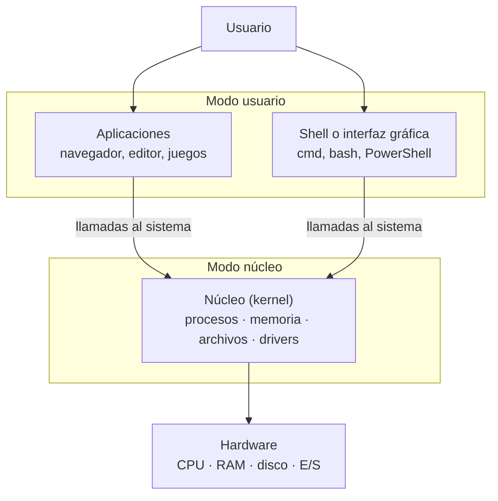

# Pruebas

????

**ME LA SÚPER PELAN TODOS ALV** 

Tarea #990

# **Investigación: Unidad I. Introducción a los Sistemas Operativos**

> **Objetivo:** describir las características de los sistemas operativos, su evolución, estructura y tipos que existen para la gestión de recursos de un sistema de cómputo local o en la nube.

Introducción

Un **sistema operativo (S.O.)** es el software que administra el hardware de una computadora y sirve de intermediario entre ese hardware, las aplicaciones y el usuario.

**Funciones principales:**

- **Procesos:** decide qué programa usa el CPU y por cuánto tiempo.
- **Memoria:** reparte la RAM y maneja la memoria virtual.
- **Archivos:** organiza cómo se guardan y leen los datos en disco.
- **Entrada/salida:** controla teclado, pantalla, red, USB, etc. mediante drivers.
- **Seguridad:** usuarios, contraseñas y permisos.

**Tipos:**

- Por usuarios: monousuario o multiusuario.
- Por tareas: monotarea o multitarea.
- Por uso: de escritorio (Windows, macOS, Linux), de servidor, móviles (Android, iOS), de tiempo real (máquinas industriales, autos) y distribuidos o en la nube, donde los recursos de muchos equipos se administran como si fueran uno solo.

1. Historia de los S.O.

Los S.O. evolucionaron junto con el hardware. Se suelen dividir en cuatro generaciones:

| Generación | Período | Tecnología | Avance principal | Ejemplos |
| --- | --- | --- | --- | --- |
| 1.ª | 1945–1955 | Tubos de vacío | Se programaba con cables, interruptores y tarjetas perforadas; no había S.O. | — |
| 2.ª | 1955–1965 | Transistores | Procesamiento por lotes (*batch*): los trabajos se agrupaban y corrían uno tras otro | FMS, IBSYS |
| 3.ª | 1965–1980 | Circuitos integrados | Multiprogramación, *spooling* y tiempo compartido (varios usuarios a la vez) | OS/360, CTSS, MULTICS, UNIX |
| 4.ª | 1980–hoy | Microprocesadores | Computadora personal, interfaces gráficas, redes y sistemas distribuidos | CP/M, MS-DOS, Windows, macOS, Linux |

Desde los años 2000 se suman los S.O. **móviles** (iOS en 2007, Android en 2008) y la **nube**, donde la virtualización permite que un mismo servidor físico ejecute muchos S.O. a la vez y los recursos se rentan por internet.

2. Estructura de los S.O.

Todo S.O. tiene un **núcleo (kernel)**, que corre en *modo núcleo* con acceso total al hardware, y una **interfaz** (shell o entorno gráfico) por la que el usuario y los programas le piden cosas. Los programas no tocan el hardware directamente: hacen **llamadas al sistema** al kernel.

Lo que cambia entre un S.O. y otro es cómo se organiza el kernel:

| Estructura | Cómo funciona | Ejemplos |
| --- | --- | --- |
| Monolítica | Todo el S.O. es un solo programa en modo núcleo. Es rápido, pero un error en un driver puede tirar todo el sistema. | UNIX clásico, Linux |
| Por capas | El S.O. se divide en niveles y cada capa solo usa los servicios de la de abajo. Es fácil de depurar, pero más lento. | THE (Dijkstra, 1968), MULTICS |
| Microkernel | El núcleo hace solo lo mínimo; drivers y sistema de archivos corren como procesos aparte. Si uno falla, el resto sigue. | Mach, L4, QNX |
| Híbrida | Mezcla las dos anteriores: diseño modular, pero varios servicios se quedan en el núcleo por velocidad. | Windows NT/10/11, macOS (XNU) |
| Máquinas virtuales | Un **hipervisor** crea varias computadoras virtuales sobre el mismo hardware, cada una con su propio S.O. Es la base de la nube. | VMware, Hyper-V, KVM |

3. Interfaces de comandos locales

Una **interfaz de línea de comandos** (CLI o *shell*) permite dar órdenes al S.O. escribiendo texto. Es más rápida que la interfaz gráfica para tareas repetitivas y permite automatizarlas con *scripts*.

a) cmd

- Es el **Símbolo del sistema** de Windows, sucesor de `COMMAND.COM` de MS-DOS.
- Automatiza tareas con archivos por lotes `.bat` o `.cmd`.
- Trabaja con texto. Microsoft hoy recomienda PowerShell en su lugar.

b) bash

- **Bourne-Again Shell**, del proyecto GNU. Lo escribió Brian Fox y salió en 1989 como reemplazo libre del Bourne shell (`sh`).
- Es el shell por defecto en la mayoría de las distribuciones Linux.
- Sus scripts son archivos `.sh` y trabaja con texto.

c) PowerShell

- Shell y lenguaje de scripting de Microsoft (versión 1.0 en 2006). Hoy funciona en Windows, Linux y macOS.
- A diferencia de cmd y bash, pasa **objetos** por la tubería en vez de texto.
- Sus comandos se llaman *cmdlets* y usan el formato Verbo-Sustantivo, como `Get-Process`. Sus scripts son `.ps1`.

**Comparación y comandos equivalentes:**

| | cmd | bash | PowerShell |
| --- | --- | --- | --- |
| Sistema | Windows | Linux, macOS, Windows (WSL) | Windows, Linux, macOS |
| Scripts | `.bat` / `.cmd` | `.sh` | `.ps1` |
| Por la tubería pasa | Texto | Texto | Objetos |
| Listar archivos | `dir` | `ls` | `Get-ChildItem` |
| Carpeta actual | `cd` | `pwd` | `Get-Location` |
| Copiar | `copy` | `cp` | `Copy-Item` |
| Borrar | `del` | `rm` | `Remove-Item` |
| Ver un archivo | `type` | `cat` | `Get-Content` |
| Limpiar pantalla | `cls` | `clear` | `Clear-Host` |
| Ayuda | `help` | `man` | `Get-Help` |

4. Variables de entorno

Son pares **nombre = valor** que el S.O. guarda para que los programas conozcan datos del sistema, como dónde buscar ejecutables o cuál es la carpeta del usuario. Siempre son texto y los procesos hijos las heredan.

- En **Windows** los nombres no distinguen mayúsculas y las rutas de `PATH` se separan con `;`.
- En **Linux** sí distinguen mayúsculas y las rutas se separan con `:`.

| Windows | Linux | Para qué sirve |
| --- | --- | --- |
| `PATH` | `PATH` | Carpetas donde se buscan los programas al escribir un comando |
| `USERPROFILE` | `HOME` | Carpeta personal del usuario |
| `USERNAME` | `USER` | Nombre del usuario |
| `COMSPEC` | `SHELL` | Intérprete de comandos predeterminado |

**Cómo usarlas en cada shell:**

| Acción | cmd | bash | PowerShell |
| --- | --- | --- | --- |
| Ver todas | `set` | `env` | `Get-ChildItem Env:` |
| Leer una | `echo %PATH%` | `echo $PATH` | `$Env:PATH` |
| Crear (solo esta sesión) | `set MIVAR=hola` | `export MIVAR=hola` | `$Env:MIVAR = 'hola'` |
| Hacerla permanente | `setx MIVAR hola` | Agregar el `export` a `~/.bashrc` | `[Environment]::SetEnvironmentVariable('MIVAR','hola','User')` |

En Windows existen tres ámbitos: **sistema** (todos los usuarios, requiere permisos de administrador), **usuario** y **proceso** (solo la ventana actual).

